# Lab 2: gNB TDD Traffic Analysis 

## Test Scenarios and Files

| Scenario | TDD setting | Traffic direction | Main idea |
| --- | --- | --- | --- |
| A | DL-heavy | Downlink | The TDD setting favors the traffic direction |
| B | DL-heavy | Uplink | There are fewer opportunities for uplink traffic |
| C | Balanced | Uplink | More uplink opportunities are available than in B |


### Configuration Captures — Task 4 Only

| TDD setting | Applies to | Configuration capture |
| --- | --- | --- |
| DL-heavy | Scenarios A and B | `tdd-dl-heavy-sib1.pcapng` |
| Balanced | Scenario C | `tdd-balanced-sib1.pcapng` |

### Performance Files — Tasks 1–3 and 5–8

| Scenario | iperf3 JSON | Scenario capture |
| --- | --- | --- |
| A | `scenario-a-downlink.json` | `scenario-a-dl-heavy-downlink.pcapng` |
| B | `scenario-b-uplink.json` | `scenario-b-dl-heavy-uplink.pcapng` |
| C | `scenario-c-uplink.json` | `scenario-c-balanced-uplink.pcapng` |


## Task 1 — Confirm the Traffic Direction


| Scenario | Reverse value | Direction |
| --- | ---: | --- |
| A | 1| Downlink|
| B | 0| Uplink|
| C | 0| Uplink|

**Question:** Does the traffic direction shown in the JSON match the scenario description? Show the proof.
> **Ans**: Yes. The field `start → test_start → reverse` is `1` in `scenario-a-downlink.json` and `0` in `scenario-b-uplink.json` and `scenario-c-uplink.json`.

scenario A:

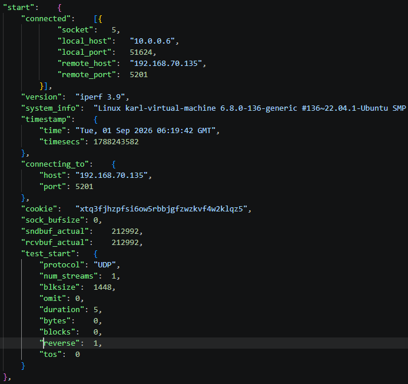

scenario B:

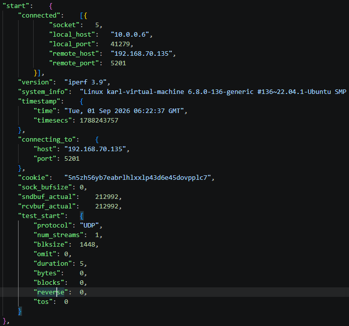

scenario C:

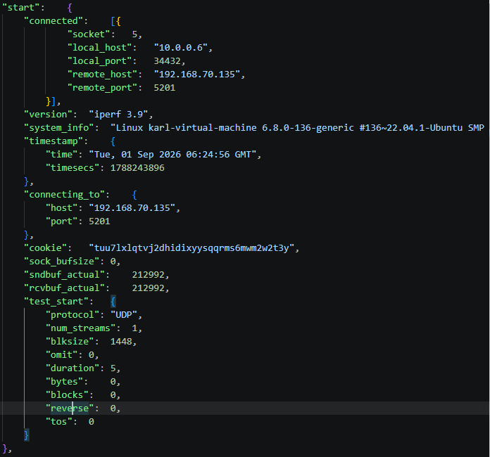


## Task 2 — Compare Throughput

| Scenario | Direction | Throughput (Mbps) |
| --- | --- | ---: |
| A | Downlink | 90.654|
| B | Uplink |109.117 |
| C | Uplink |124.417 |

Calculate how much C improves over B:

```text
Improvement (%) = (C - B) ÷ B × 100
```
> **Ans**: (124.417-109.117) ÷ 109.117 × 100 = 14.02%

Answer:

1. What is the downlink throughput in Scenario A?
> **Ans**: 90.654 Mbps
2. What is the uplink throughput in Scenario B?
> **Ans**: 109.117 Mbps
3. Is the uplink throughput higher in B or C?
> **Ans**: Uplink throughput is higher in C (124.417>109.117)
4. By approximately what percentage does C improve over B?
> **Ans**: C improves over B by approximately 14.02 % 
> (124.417-109.117) ÷ 109.117 × 100 = 14.02%


## Task 3 — Check the Trade-off

| Scenario | Throughput (Mbps) | Packet loss (%) | Jitter (ms) |
| --- | ---: | ---: | ---: |
| B |109.117  |0.236 |0.116 |
| C | 124.417 |	2.134|0.162 |

Answer:

1. Does C have higher uplink throughput than B?
> **Ans**: Yes, C has higher uplink throughput than B (124.417Mbps > 109.117Mbps)
2. Does C have lower packet loss than B?
> **Ans**: No, C has higher packet loss than B. (2.134% > 0.236%)

3. What trade-off, if any, is visible when changing from B to C?
 > **Ans**: Compared with Scenario B, Scenario C has higher throughput (124.417Mbps vs 109.117 Mbps), higher packet loss (2.134 % vs 0.236 %), and higher jitter (0.162ms vs 0.116 ms). These results suggest that the extra uplink opportunities let the UE deliver more data, but in this test the throughput gain was accompanied by lower reliability. This is a trade-off observed in these runs rather than a general rule: more UL resources do not necessarily increase packet loss, but they also do not guarantee better overall quality.


## Task 4 — Read SIB1 and Draw the TDD Configuration

| Item | DL-heavy: A/B | Balanced: C |
| --- | --- | --- |
| Configuration capture filename | `tdd-dl-heavy-sib1.pcapng` |`tdd-balanced-sib1.pcapng` |
| SIB1 packet number |2 |2 |
| `referenceSubcarrierSpacing` (kHz) |30 kHz | 30 kHz|
| `dl-UL-TransmissionPeriodicity` (ms) |5 | 2.5|
| `nrofDownlinkSlots` |7 | 2|
| `nrofDownlinkSymbols` |6 | 6|
| `nrofUplinkSlots` |2 | 2|
| `nrofUplinkSymbols` | 4| 4|
| Is `pattern2` present? |No |No |

`tdd-dl-heavy-sib1.pcapng`:
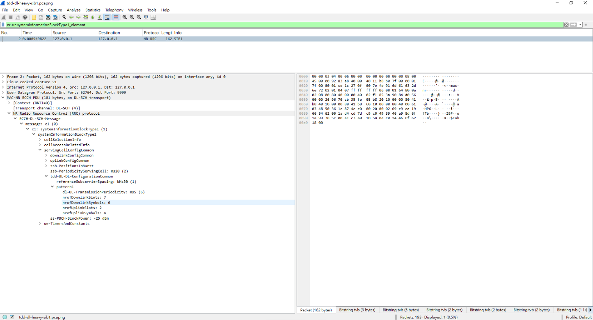
`tdd-balanced-sib1.pcapng`
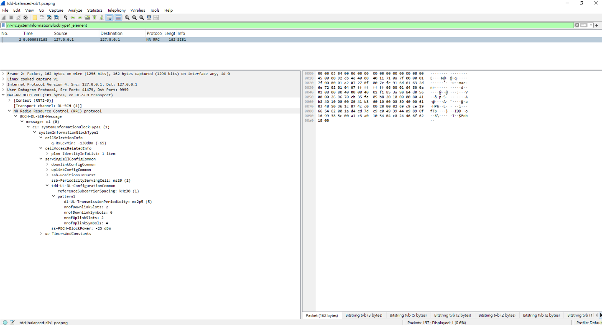


### Draw the TDD Time Allocation
For the normal cyclic prefix used in this exercise, each reference slot contains 14 OFDM symbols, numbered 0–13.
DL-heavy:
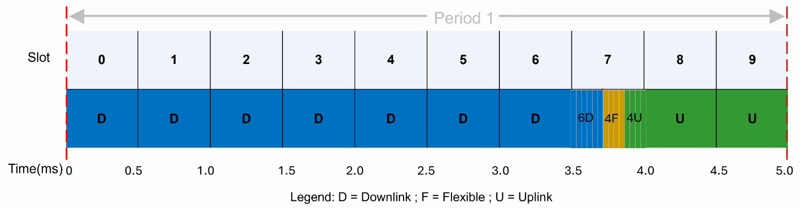
Balanced:
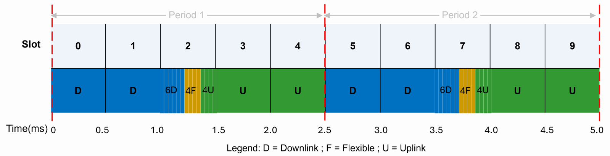


| TDD setting | Repeating duration (ms) | Total reference slots | DL symbols | UL symbols | Flexible symbols | Configured UL symbol share (%) |
| --- | ---: | ---: | ---: | ---: | ---: | ---: |
| DL-heavy |5 | 10|104 |32 |4 |22.86 |
| Balanced | 2.5| 5 | 34|32 |4 | 45.71|


| TDD setting | Repeating duration (ms) | Repetitions in 5 ms | DL symbols in 5 ms | UL symbols in 5 ms | Flexible symbols in 5 ms |
| --- | ---: | ---: | ---: | ---: | ---: |
| DL-heavy | 5|1 |104 |32 |4 |
| Balanced |2.5 |2 |68 |64 |8 |

**Question:** Can two patterns have the same UL symbol count per period but provide different numbers of UL symbols per unit time? Explain using your two tables.
> **Ans**: Yes. Both configurations have exactly 32 UL symbols per period (first table), but the balanced period is 2.5 ms while the DL-heavy period is 5 ms. Over the same 5 ms the balanced pattern repeats twice and provides 64 UL symbols (12.8 per ms) versus 32 (6.4 per ms) for DL-heavy (second table). Per-period counts must therefore be normalised by the period length before comparing resources.
### Connect SIB1 to the Performance Results

| Scenario | Reference TDD setting | JSON traffic direction | Configured UL symbol share (%) | Throughput (Mbps) | Packet loss (%) |
| --- | --- | --- | ---: | ---: | ---: |
| A | DL-heavy |Downlink |22.86 |90.654 |0.443 |
| B | DL-heavy |Uplink |22.86 |109.117 |0.236 |
| C | Balanced |Uplink| 45.71|124.417 | 2.134|

Answer:

1. Which decoded TDD parameters differ between DL-heavy and balanced?
> **Ans**: `dl-UL-TransmissionPeriodicity` (5 ms vs 2.5 ms). 
2. Which configuration provides more configured UL symbols per unit time? Support your answer with the diagram and calculated share.
> **Ans**: Balanced. Its diagram shows a UL block in every 2.5 ms period (two UL blocks in 5 ms), giving 64 UL symbols per 5 ms versus 32, and a configured UL share of 45.71 % versus 22.86 %.
3. How does that difference help explain the B/C throughput comparison?
> **Ans**: B and C use the same iperf3 settings, so the main configured difference is the TDD pattern. The balanced pattern gives twice as many UL symbols per unit time (64 vs 32 per 5 ms), so the UE has more uplink transmission opportunities, which is consistent with C's higher throughput (124.42 vs 109.12 Mbps). However, even with twice the UL resources, C improved by only 14 % and still did not reach the 150 Mbps target, so the TDD pattern is not the only limiting factor.

4. Why can A and B use the same SIB1 TDD configuration even though their traffic directions differ?
> **Ans**: The TDD pattern in SIB1 is a cell-wide setting broadcast to all UEs, so it doesn't depend on any one UE's traffic. The iperf3 direction (`reverse`) is chosen per test, so A sends DL data in the D symbols and B sends UL data in the U symbols of the same pattern.


### Optional Observation — PRACH Configuration Index

| TDD setting | SIB1 packet number | PRACH configuration index |
| --- | ---: | ---: |
| DL-heavy | 2|98 |
| Balanced | 2|98 |


## Task 5 — Is the TDD Setting Suitable?

| Scenario | TDD setting | Traffic direction | Is the setting suitable for this direction? Why? |
| --- | --- | --- | --- |
| A | DL-heavy | Downlink |  Yes. 104 of 140 symbols are DL, so downlink traffic has many transmission opportunities.|
| B | DL-heavy | Uplink |  Not well suited. Only 32 of 140 symbols are UL, so uplink traffic must wait for one short UL window every 5 ms.  |
| C | Balanced | Uplink | Yes, and it's more suitable than B. 64 of 140 symbols are UL, with a UL window every 2.5 ms.|


**Question:** Why might Scenario C achieve better uplink throughput than Scenario B? Refer to your SIB1 diagrams and measured results.
> **Ans**: The balanced pattern repeats every 2.5 ms, so it offers 64 instead of 32 UL symbols in the same 5 ms. The UE can therefore send more uplink data per unit time, and queued data waits less for the next UL slot.

## Task 6 — Find GTP-U Information

| Item | Value |
| --- | --- |
| Scenario capture filename |`scenario-a-dl-heavy-downlink.pcapng` |
| Packet number |1892 |
| Outer source IP |192.168.70.134 |
| Outer destination IP | 192.168.70.129|
| Inner source IP |192.168.70.135 |
| Inner destination IP |10.0.0.6 |
| TEID |0xcddc4529 |

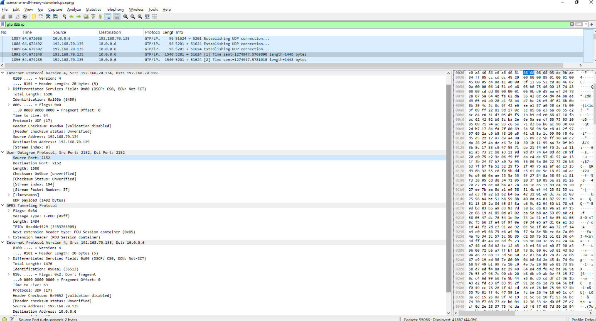


## Task 7 — TCP Retransmissions

| Scenario | Displayed TCP retransmissions |
| --- | ---: |
| A |14 |
| B | 12|
| C | 12|

Scenario A:
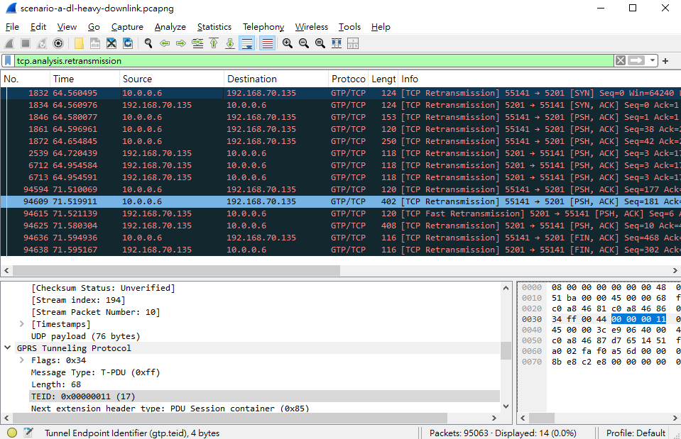
Scenario B:
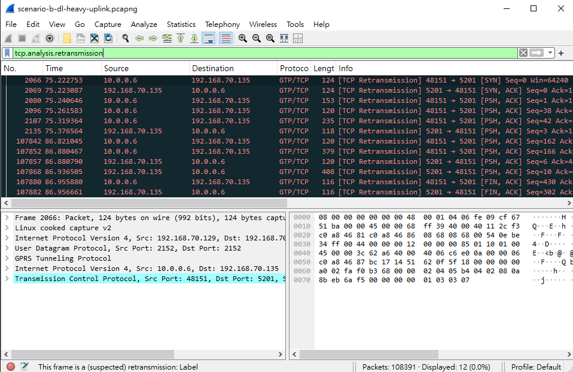
Scenario C:
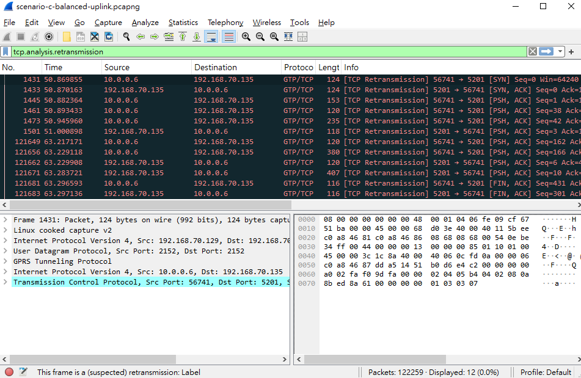


**Question:** Do these TCP retransmissions directly represent lost UDP performance packets?
> **Ans**: No. They come from the TCP control connection that iperf3 uses for setup and result exchange, not from the UDP data stream.
> 
## Task 8 — RTT and Packet Interval

| Scenario | Packet number | Example TCP ACK RTT |
| --- | ---: | --- |
| A |1842 |0.018162 s |

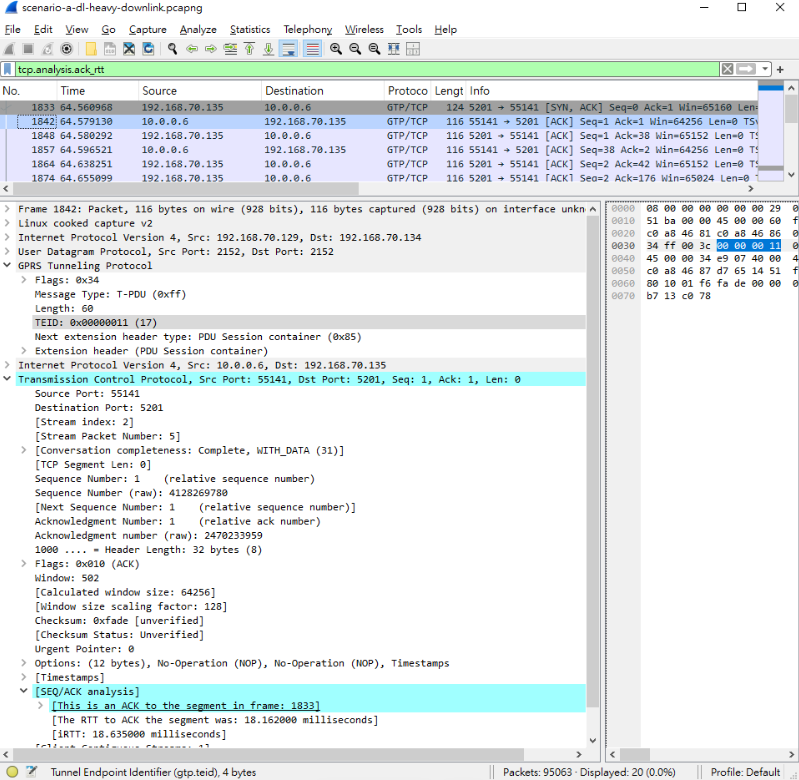

### Packet Interval

| Scenario | Display filter | Packet numbers | Time interval |
| --- | --- | --- | --- |
| A| `udp.dstport == 51624 && sll.ifindex == 41` |1898 → 1900 | 0.000081 s |

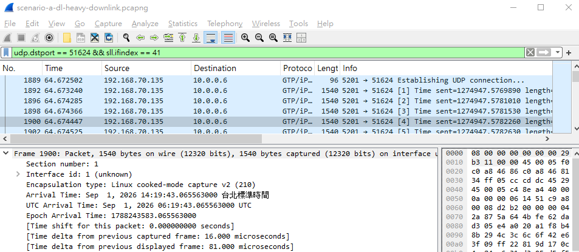


## Final Questions

1. Does Scenario A use a TDD setting that matches its traffic direction?
> **Ans**: Yes. It uses DL-heavy TDD, where 104 of 140 symbols per 5 ms (74.3 %) are configured DL.
2. Why is Scenario B expected to have limited uplink resources? Cite a parameter or count from the DL-heavy SIB1 reference configuration.
> **Ans**: The DL-heavy SIB1 has `nrofDownlinkSlots = 7` but only `nrofUplinkSlots = 2` and `nrofUplinkSymbols = 4` per 5 ms period. That gives 32 UL symbols out of 140 (22.86 %), only about 1.14 ms of uplink time in every 5 ms.
3. How much does uplink throughput change from B to C?
> **Ans**: It rises from 109.12 Mbps (B) to 124.42 Mbps (C), an increase of 15.30 Mbps.
4. What negative result, if any, is visible in C? Support your answer with packet loss or jitter values.
> **Ans**: C has worse reliability than B. Packet loss rose from 0.236 % to 2.134 %, and jitter rose from 0.116 ms to 0.162 ms.

5. Why can increasing UL resources improve uplink throughput?
> **Ans**: The UE can transmit uplink data (PUSCH) only in UL symbols, so more UL symbols per unit time means more transmission opportunities and more resources for uplink data each second.
6. Is adding more UL resources always the best solution? Explain using throughput and packet loss.
> **Ans**: Not always. From B change to C shows a small gain in throughput (+14 %) but a large cost in reliability (packet loss 0.236 % → 2.134 %).

7. Suggest one simple follow-up test that could improve throughput without producing too much packet loss.
> **Ans**: Keep the balanced configuration and repeat the uplink UDP test at lower target rates, running each test longer and several times. 


8. What can the configuration captures tell you that the iperf3 JSON cannot? Why are separately recorded configuration captures not direct proof of the configuration during an earlier test?
> **Ans**: The configuration captures show the TDD settings broadcast in SIB1 (SCS, period, and DL/UL slot and symbol counts), which the iperf3 JSON does not contain. However, they were recorded separately from the iperf3 tests, so they cannot prove that the gNB used the same settings during those runs.


