# Lab 3: Deploying a 5G Standalone Network Using OpenAirInterface

## Experimental Environment

| Component | Configuration |
|---|---|
| Ubuntu | 22.04 |
| OAI RAN | v2.4.0 |
| 5G Core | OAI CN5G |
| gNB | nr-softmodem |
| UE | nr-uesoftmodem |
| Radio interface | RFsimulator |
| Band | n78 |
| Subcarrier spacing | 30 kHz |
| Resource blocks | 106 |
| UE IMSI | 001010000000001 |
| External DN | 192.168.70.135 |


## Task 1 — Deploy and Verify the Complete 5G SA Network

| Stage | Successful? | Evidence from logs |
|---|---|---|
| CN5G initialization |Yes |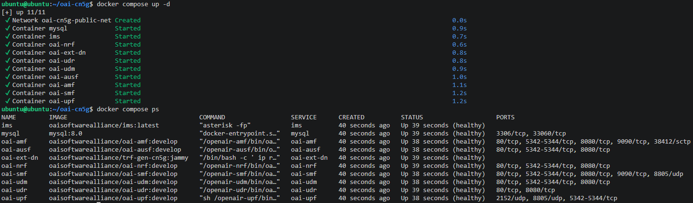|
| gNB NG Setup | Yes|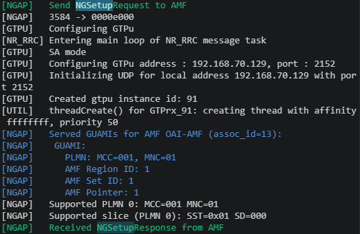|
| UE synchronization |Yes |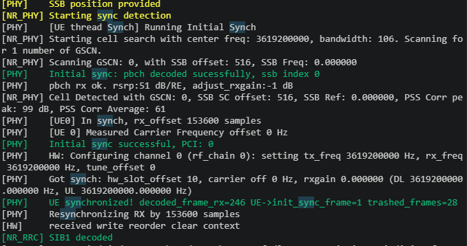 |
| RRC connection establishment |Yes |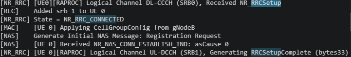|
| UE Registration |Yes ||
| PDU Session Establishment | Yes| 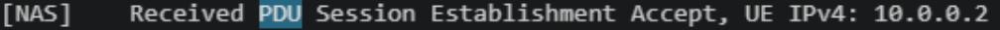|
| UE tunnel creation |Yes |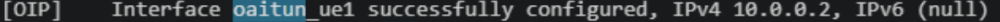|

The gNB and UE successfully connected.
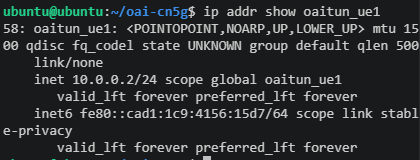


**Questions:**

1. Does a successful NG Setup guarantee that a UE can register? Explain.
> **Ans**: No. NG Setup only establishes the N2 connection between the gNB and the AMF. UE registration also requires the UE to be a valid subscriber in the core network and to pass authentication.
2. Why can the UE establish an RRC connection but still fail Registration?
> **Ans**: RRC connection is established between the UE and the gNB without checking the subscriber identity. Registration is checked by the core network, so it can still be rejected if the IMSI is not provisioned or authentication fails.
3. What additional procedure is required after Registration before user data can be exchanged?
> **Ans**: PDU Session Establishment, which assigns the UE an IP address and sets up the user-plane path

## Task 2 — Investigate RFsimulator Communication

Complete the table:

| Item | Observed Value |
|---|---|
| gNB process ID | 3398514 |
| nrUE process ID |3497291 |
| RFsimulator transport protocol |TCP |
| RFsimulator port | 4043|
| TCP connection state |ESTAB |
| Connected process(es) |nr-uesoftmodem (pid 3497291, 127.0.0.1:44828) ↔ nr-softmodem (pid 3398514, 127.0.0.1:4043) |

Take one screenshot showing the TCP connection.
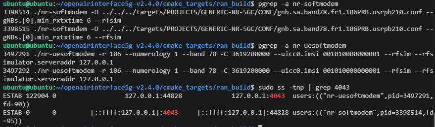

**Questions:**

1. Why does RFsimulator use a TCP connection instead of a physical antenna?
> **Ans**:  Since the gNB and UE exchange only digital IQ samples with the radio hardware, RFsimulator can replace the antenna with a TCP connection that delivers these IQ samples directly between them.
2. Are the TCP packets exchanged by RFsimulator the same as the UE's application-layer IP packets?
> **Ans**: No. The RFsimulator TCP packets carry baseband IQ samples. The UE's IP packets go through the 5G protocol stack and only become part of those IQ samples after physical-layer processing.
3. Does using RFsimulator mean that the UE and gNB are performing no physical-layer processing? Explain.
> **Ans**: No. Only the RF hardware and the wireless channel are replaced, the gNB and UE still perform physical-layer processing.

## Task 3 — Verify End-to-End Connectivity


Record:

| Measurement | Observed Value |
|---|---|
| UE IP address |10.0.0.2 |
| Destination IP |192.168.70.135 |
| Packets transmitted |10 |
| Packets received | 10|
| Packet loss (%) |0% |
| Minimum RTT (ms) |3.759 |
| Average RTT (ms) | 5.710|
| Maximum RTT (ms) | 7.169|

Take a screenshot of the Ping result.
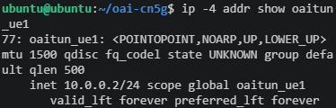

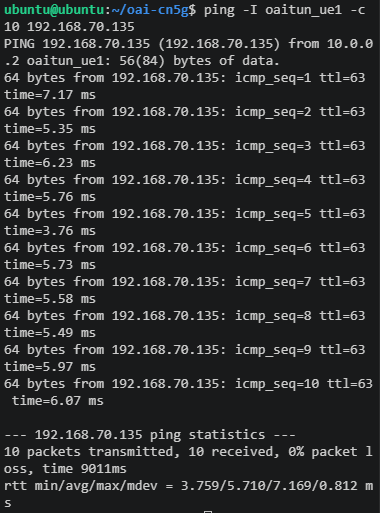

**Questions:**

1. Why must Ping use the `oaitun_ue1` interface in this experiment?
> **Ans**: The host has the address 192.168.70.129/26 on the Docker bridge `oai-cn5g`, which is in the same subnet as 192.168.70.135, so it can reach the DN directly. Using `oaitun_ue1` makes the packets go through the UE, gNB and UPF, so the ping actually tests the 5G user plane.
2. Does successful Registration guarantee successful user-plane connectivity?
> **Ans**: No. Registration is only a control-plane procedure. User data also requires a successful PDU Session Establishment and a working path through the UPF.
3. What does a successful Ping prove, and what does it not prove about the simulated 5G system?
> **Ans**: It proves that the PDU session works and that packets can travel between the UE and the external DN in both directions. It does not prove real radio performance or over-the-air latency, because there is no real wireless channel.

## Task 4 — Investigate the Effect of Packet Size

Complete the table:

| Scenario | ICMP Payload | Avg. RTT (ms) | Max. RTT (ms) | Packet Loss (%) |
|---|---:|---:|---:|---:|
| A | 56 bytes | 5.437|8.216 |0% |
| B | 512 bytes | 6.738|15.242 |0% |
| C | 1200 bytes |8.091 |10.657 |0% |

Scenario A:
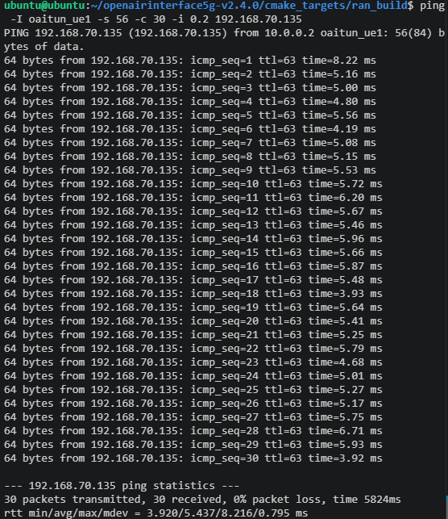
Scenario B:
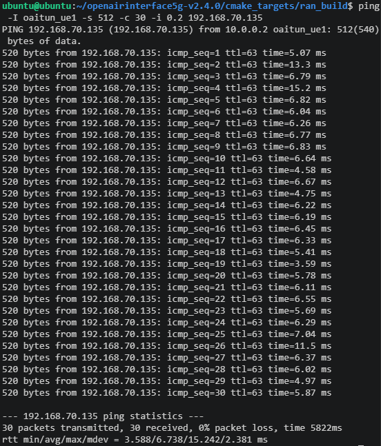
Scenario C:


Calculate the RTT difference:

```text
RTT Difference = Average RTT(C) - Average RTT(A)
               = 8.091 ms - 5.437 ms
               = 2.654 ms
```

**Questions:**

1. Which scenario has the highest average RTT?
> **Ans**: Scenario C 
2. Does increasing packet size always increase RTT in your measurements?
> **Ans**: Not always. The average RTT increased (A: 5.437 ms, B: 6.738 ms, C: 8.091 ms), but individual packets didn't always follow this trend: the maximum RTT of B (15.242 ms) is higher than that of C (10.657 ms).
3. Why might a larger packet require more transmission or processing resources?
> **Ans**: A larger packet has more bits, so it needs more radio resources (PRBs or slots) and more encoding, decoding and protocol processing.
4. What factors other than packet size could affect RTT in a software-based 5G network?
> **Ans**: Software scheduling, the CPU load of the machine, the RFsimulator transfer of IQ samples over TCP, and the processing time in the core network.
5. Can these results be interpreted as real over-the-air 5G latency? Explain.
> **Ans**: No, RFsim RTT is not a direct measurement of over-the-air 5G latency. RFsimulator doesn't have real wireless channel or RF hardware, and everything runs in software on one VM, so the RTT doesn't reflect over-the-air latency.


## Task 5 — Diagnose a Controlled UE Registration Failure

Complete the table:

| Item | Observation |
|---|---|
| Modified parameter |`--uicc0.imsi`: `001010000000001` → `001010000000099` |
| UE synchronized with gNB? |Yes, 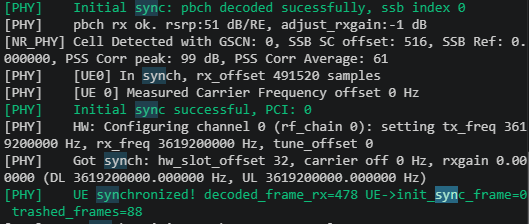 |
| RRC connection established? |Yes, 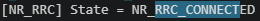|
| Registration successful? |No,  |
| Error or rejection evidence |The UE received a 5GS Registration Reject (4 bytes) from the AMF, and the OAI UE reported Registration reject message too short.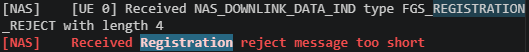|
| Likely cause |IMSI `001010000000099` is not provisioned in the CN5G subscriber database, so the AMF rejected the registration. |

**Questions:**

1. Why can the UE potentially synchronize with the gNB even when the IMSI is incorrect?
> **Ans**: Synchronization uses broadcast signals that don't check the UE's identity. The IMSI is only checked by the core network during Registration.
2. Which network function is involved in UE authentication?
> **Ans**: AUSF (Authentication Server Function).
3. Why does changing an IMSI affect Registration but not the RFsimulator TCP connection itself?
> **Ans**:  The RFsimulator TCP connection only carries IQ samples and does not use the UE's identity. The IMSI is used only in NAS Registration with the core network, so changing it affects Registration but not the TCP connection.
4. What evidence proves that restoring the correct configuration solved the problem?
> **Ans**: After restoring IMSI `001010000000001`, the AMF shows the UE as `5GMM-REGISTERED` with a GUTI, `oaitun_ue1` gets the IP address 10.0.0.2, and the ping to 192.168.70.135 succeeds with 0% packet loss.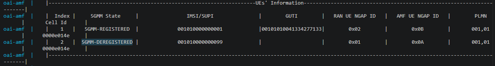
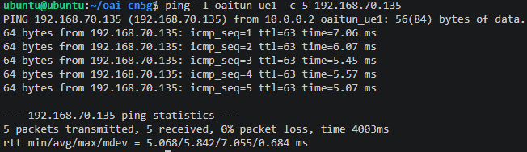


## Task 7 — Explain the Relationship Between Simulation and Real 5G
Complete the comparison:

| Feature | OAI RFsimulator | Physical 5G System |
|---|---|---|
| gNB and UE protocol stack | Yes (runs in software)|Yes|
| OFDM signal processing |Yes (IQ samples sent over TCP)|Yes (IQ samples sent through RF hardware)|
| Physical antennas |No (replaced by a TCP connection)|Yes|
| RF hardware impairments |Not inherently|Yes|
| Wireless propagation effects |Not inherently |Yes|
| 5G Core connectivity |Yes (OAI CN5G in Docker)|Yes|

**Questions:**

1. Which parts of the 5G system remain functional when physical RF hardware is replaced with RFsimulator?
> **Ans**: The full gNB and UE protocol stacks ,including OFDM processing, and the 5G Core connectivity remain functional. Only the RF hardware and the wireless channel are replaced.
2. Why is RFsimulator useful for testing the 5G protocol stack?
> **Ans**: It needs no RF hardware or licensed spectrum, and its ideal channel makes results reproducible, so problems can be traced to the protocol or configuration.
3. Why might latency and throughput differ between RFsimulator and a real 5G deployment?
> **Ans**: RFsimulator has no real wireless channel or RF hardware, and everything runs in software on one machine. A real network has propagation, fading and retransmissions, but uses dedicated hardware.
4. What would need to change if you wanted to test a physical UE instead of OAI nrUE?
> **Ans**:  Replace RFsimulator with real RF hardware (a USRP with antennas, without --rfsim), make sure the phone supports band n78 with the configured frequency and bandwidth, and use a SIM card whose IMSI is provisioned in the CN5G subscriber database.

## Final Analysis

Answer each question in three to five sentences.

1. Describe the complete process from starting the OAI 5GC to successful user-plane connectivity.
> **Ans**:  First, the OAI CN5G containers are started with Docker Compose and become healthy. The gNB then connects to the AMF and completes NG Setup, and the nrUE connects to the gNB through RFsimulator and synchronizes. The UE establishes an RRC connection, registers with the core network, and sets up a PDU session that gives it the IP address 10.0.0.2 on oaitun_ue1. Finally, a ping from `oaitun_ue1` to 192.168.70.135 succeeded with 0% loss, confirming user-plane connectivity.
2. Explain the difference between an RFsimulator TCP connection and a 5G PDU Session.
> **Ans**: The RFsimulator TCP connection replaces the radio channel and carries IQ samples between the gNB and the UE, whereas a PDU session is a 5G user-plane connection that carries the UE's IP packets to the data network through the UPF. The TCP connection is created as soon as the UE starts and does not depend on the UE's identity. A PDU session is set up by the core network only after successful registration, and it gives the UE its IP address.
3. Based on your measurements, how did packet size affect RTT and packet loss?
> **Ans**: The average RTT increased with packet size, from 5.437 ms (56 bytes) to 6.738 ms (512 bytes) and 8.091 ms (1200 bytes). However, the maximum RTT did not increase with packet size (8.216, 15.242 and 10.657 ms), which shows that RTT does not necessarily increase monotonically with packet size, because software scheduling also has an effect. Packet loss was 0% in all three scenarios.
4. Describe the registration failure you introduced and explain how you diagnosed and recovered from it.
> **Ans**: I restarted the UE with the IMSI changed to 001010000000099, which is not provisioned in the CN5G database. The UE still synchronized and established an RRC connection, but the AMF rejected its registration. Since synchronization and RRC worked, the problem was caused by the unknown IMSI during registration with the core network. After restoring IMSI 001010000000001, the UE registered successfully and the ping worked again.
5. Identify two limitations of this simulated environment and explain how they might affect experimental results.
> **Ans**: First, RFsimulator has no real wireless channel or RF hardware, so there is no fading, interference or signal loss. This is why packet loss was 0%, and the results cannot show real radio performance. Second, the gNB, the UE and the core network all run in software on one VM without real-time guarantees. As a result, the RTT and its variation depend on CPU load, so they do not represent real over-the-air 5G latency.


