# Lab 5: From Initial Access to RRC Connection Setup (Student Guide)

## Task 1: From Cell Search to Msg2 RAR — 35 points

Complete the following four steps in order. For each step, provide the requested values or screenshots and briefly explain what the evidence shows and why it matters in the access procedure.

### Step 1: Find Cell Search and Initial Synchronization — 8 points

Run the following command on `Lab5-ue.log`:

```bash
grep -nE 'Starting cell search|Initial sync successful' lab5-artifacts/Lab5-ue.log
```
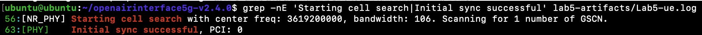

Record whether UE synchronization succeeded and the PCI value. Explain: after completing initial synchronization, what is the UE able to do?
> **Ans**:
> 1. UE synchronization succeeded
> 2. PCI value: 0
> 3. After initial synchronization, the UE has detected the cell, is synchronized in time and frequency, and knows the Physical Cell ID. It can therefore read the PBCH, which carries the MIB.
### Step 2: Find MIB and SIB1 — 8 points

In Wireshark, enter:

```text
nr-rrc
```

Find one `MIB` packet and one `SIB1` packet. Record the frame number of each and provide screenshots.
> **Ans**:
> MIB：frame 2
> SIB1：frame 3

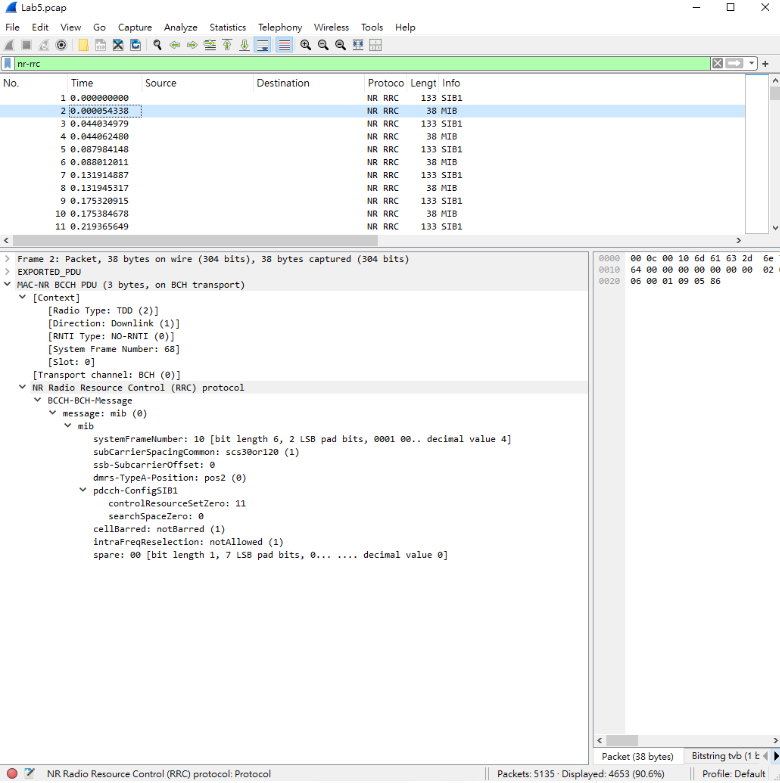

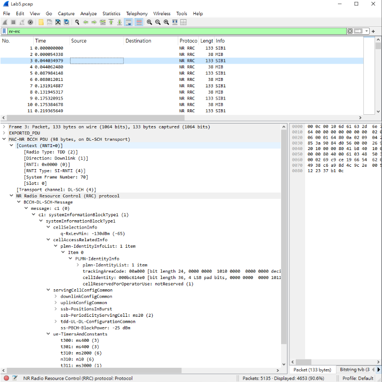


MIB and SIB1 are repeatedly broadcast system-information messages. The UE must obtain the common configuration before it can continue the access procedure. Briefly explain the purpose of MIB and SIB1 for UE access.
> **Ans**:
> The MIB tells the UE where to find SIB1. SIB1 tells the UE how to access the cell, including the RACH configuration. The UE needs this common configuration before it can continue the access procedure.

### Step 3: Find Msg1 PRACH — 8 points

Run the following command on the UE log:

```bash
grep -nE 'PRACH' lab5-artifacts/Lab5-ue.log
```

Record the Msg1 log line number. From the line that shows the actual PRACH transmission, find:

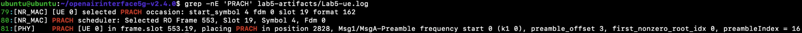

> **Ans**:
> Msg1 log line = **81**
> frame.slot = **553.19**
> preambleIndex = **16**

Next, return to Wireshark. Clear the display filter, press `Cmd/Ctrl + F`, choose **Packet details** as the search scope, and search for:

```text
RACH Preamble chosen
```

After locating the PRACH event recorded by the gNB tracer, record:


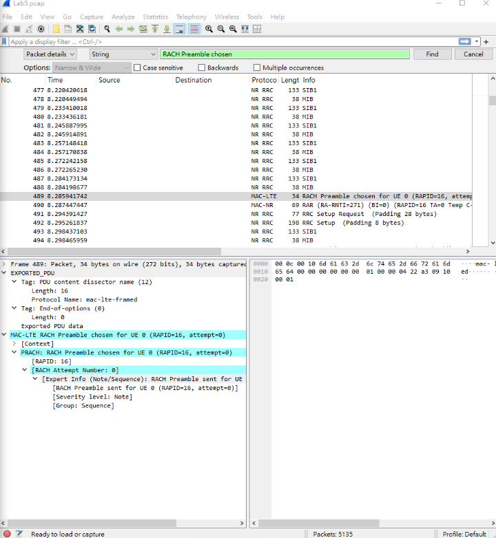

> **Ans**:
> RAPID = **16**

This packet is displayed as `MAC-LTE RACH Preamble chosen`; it is the OAI tracer MAC-event format.

Submit one UE-log screenshot and one Wireshark screenshot. Briefly answer:

1. Which Random Access message is this PRACH transmission?
> **Ans**: Msg1 (the PRACH preamble).
2. At which `frame.slot` and with which `preambleIndex` does the UE log show transmission?
> **Ans**: `frame.slot` 553.19, `preambleIndex` 16.
3. Does the Wireshark `RAPID` match the UE-log `preambleIndex`? What does this show?
> **Ans**: Yes, both are 16. This shows the gNB detected the same preamble that the UE transmitted.

### Step 4: Find Msg2 RAR in Wireshark — 11 points

Return to Wireshark and clear the display filter. Press `Cmd/Ctrl + F`, choose **Packet details** as the search scope, and search for `RAR` or `Random Access Response`. After locating the packet, record its frame number and find the following values in `MAC-NR RAR`:

> **Ans**: 
> frame number = **490**
> RAPID = **16**
> Temporary C-RNTI = **0xf21e(61982)**

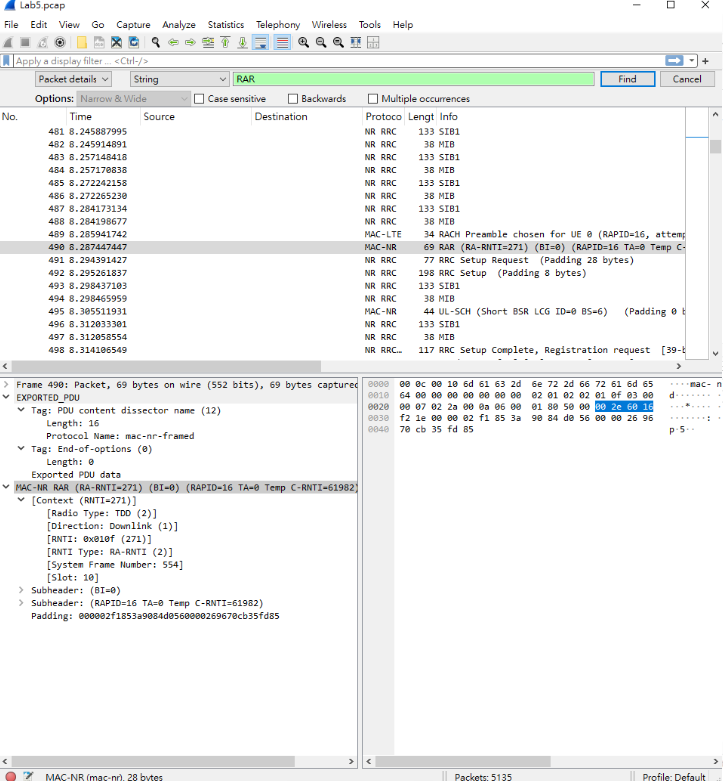

> **Ans**: The RAR answers preamble 16 and gives the UE the Timing Advance, the UL Grant for Msg3, and the Temporary C-RNTI 0xf21e.

## Task 2: Complete Random Access and RRC Connection Setup — 40 points

Complete the following steps in order. For each message, provide a screenshot and record the requested frame number, fields, and brief explanation.

### Step 1: Find RRCSetupRequest — 10 points

In Wireshark, use:

```text
nr-rrc.rrcSetupRequest_element
```

Expand `UL-CCCH-Message → rrcSetupRequest` and find:

> **Ans**:
> Frame number = **491**
> Context RNTI = **0xf21e(61982)**

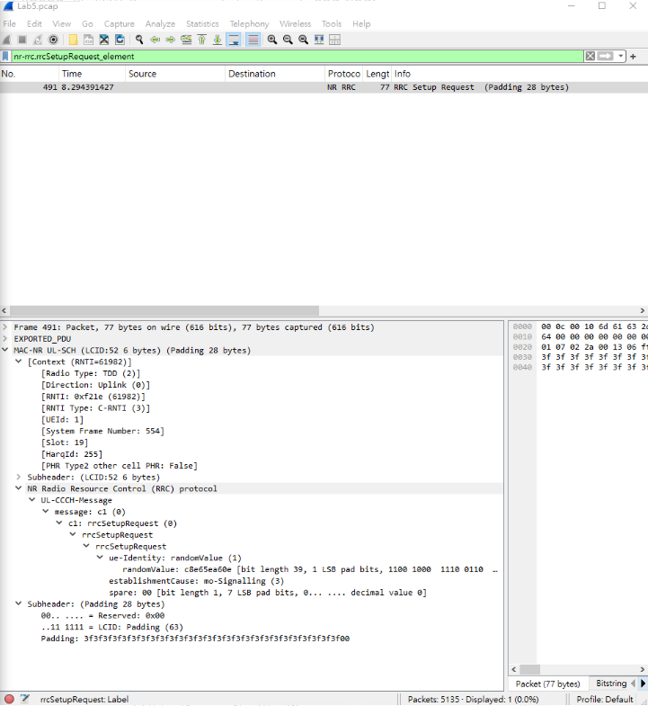

Briefly answer:

1. Does the `Context RNTI` match the `Temporary C-RNTI` in the Task 1 / Step 4 RAR? What does this show?
> **Ans**: Yes, both are 0xf21e (61982). This shows the RRCSetupRequest belongs to the same Random Access attempt that received this Temporary C-RNTI in the RAR.
2. Can you claim that the RRC connection has been established after seeing only `RRCSetupRequest`? Why or why not?
> **Ans**: No. RRCSetupRequest is only Msg3, a request. The connection is established only after the gNB responds with RRCSetup and the UE completes it with RRCSetupComplete.
### Step 2: Find RRCSetup — 10 points

Clear the previous filter and enter:

```text
nr-rrc.rrcSetup_element
```

Expand `DL-CCCH-Message → rrcSetup` and find:

> **Ans**: 
> Frame number = **492**
> Context RNTI = **0xf21e (61982)**
> rrc-TransactionIdentifier = **1**


Check whether `Contention Resolution` also appears in the packet.
> **Ans**: Yes, UE Contention Resolution Identity = 1c8e65ea60e6

Below the screenshot, briefly answer:

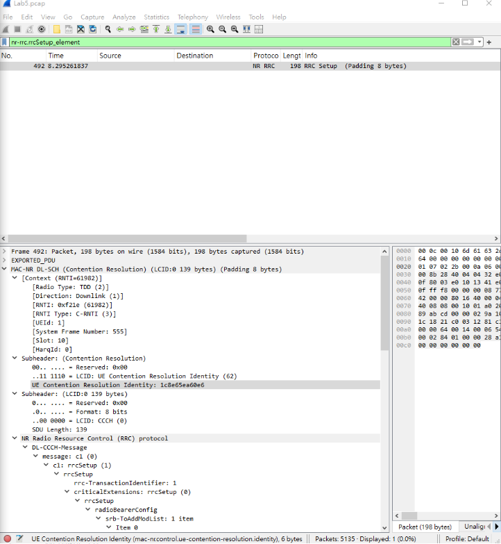

1. Which message is this in four-step Random Access?
> **Ans**: Msg4.
2. What does it mean that `Contention Resolution` and `RRCSetup` appear in the same downlink message?
> **Ans**: The same Msg4 ends Random Access (contention resolution) and starts RRC setup (RRCSetup): the UE learns it won contention and receives its RRC setup together.

### Step 3: Find RRCSetupComplete — 12 points

Clear the previous filter and enter:

```text
nr-rrc.rrcSetupComplete_element
```

Select the packet and first verify that `MAC-NR UL-SCH` appears at the top. Expand:

```text
RLC-NR → PDCP-NR → NR Radio Resource Control (RRC) protocol
  → UL-DCCH-Message → message: c1
```

Expand `message: c1` further and confirm that it contains `rrcSetupComplete`. Record:

> **Ans**:
> Frame number = **498**
> Context RNTI = **0xf21e(61982)**
> rrc-TransactionIdentifier = **1**

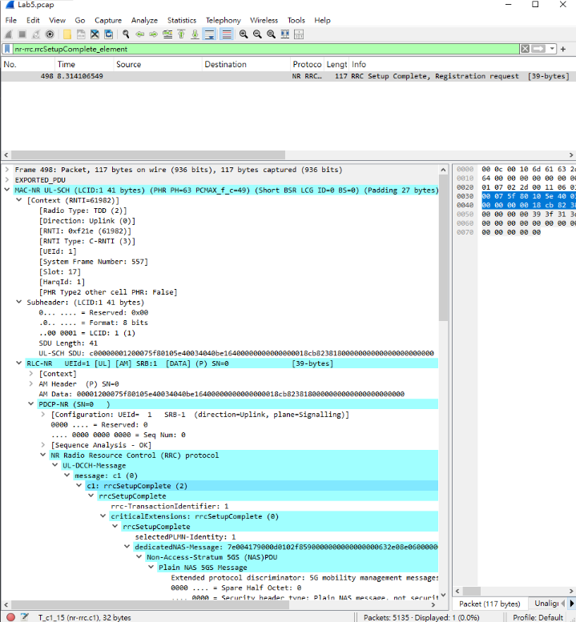

Below the screenshot, briefly answer:

1. Does the `Context RNTI` still match the `Temporary C-RNTI` in the RAR?
> **Ans**: Yes, it is still 0xf21e. The `Temporary C-RNTI` has become the UE's `C-RNTI`.
2. Does the `rrc-TransactionIdentifier` match the `RRCSetup` in Step 2? What is the purpose of this comparison?
> **Ans**: Yes, both are 1. The comparison confirms that this RRCSetupComplete is the response to that `RRCSetup`.

### Step 4: Confirm the Final Random Access and RRC Connection Result — 8 points

Run the following command on the UE log:

```bash
grep -nE '4-Step RA procedure succeeded|Received NR_RRCSetup|RRCSetupComplete|State = NR_RRC_CONNECTED' \
  lab5-artifacts/Lab5-ue.log
```

From the output, record:

> **Ans**:
> 4-Step RA procedure succeeded: line **87**
> Received NR_RRCSetup: line **88**
> State = NR_RRC_CONNECTED: line **90**
> Generating RRCSetupComplete: line **93**


Submit a screenshot of this log output and briefly answer:

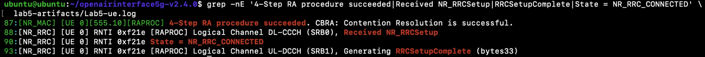

1. In log order, what are the three events from successful Random Access to generating `RRCSetupComplete`?
> **Ans**:  4-Step RA procedure succeeded → Received NR_RRCSetup → State = NR_RRC_CONNECTED
2. What do `4-Step RA procedure succeeded` and `State = NR_RRC_CONNECTED` each prove?
> **Ans**: 
> `4-Step RA procedure succeeded` proves that Random Access completed and contention resolution succeeded. 
> `State = NR_RRC_CONNECTED` proves the UE moved from `RRC_IDLE` to `RRC_CONNECTED`. 
## Task 3: Draw an Initial Access MSC Diagram — 25 points

Using the log and Wireshark evidence found in Tasks 1 and 2, draw your own Message Sequence Chart (MSC). It must include two vertical lifelines, `UE` and `gNB`, and the following six messages: MIB/SIB1, Msg1, Msg2, Msg3, Msg4, and `RRCSetupComplete`.
Determine and draw the correct order and direction of the messages yourself. Add a one-sentence purpose next to each arrow.
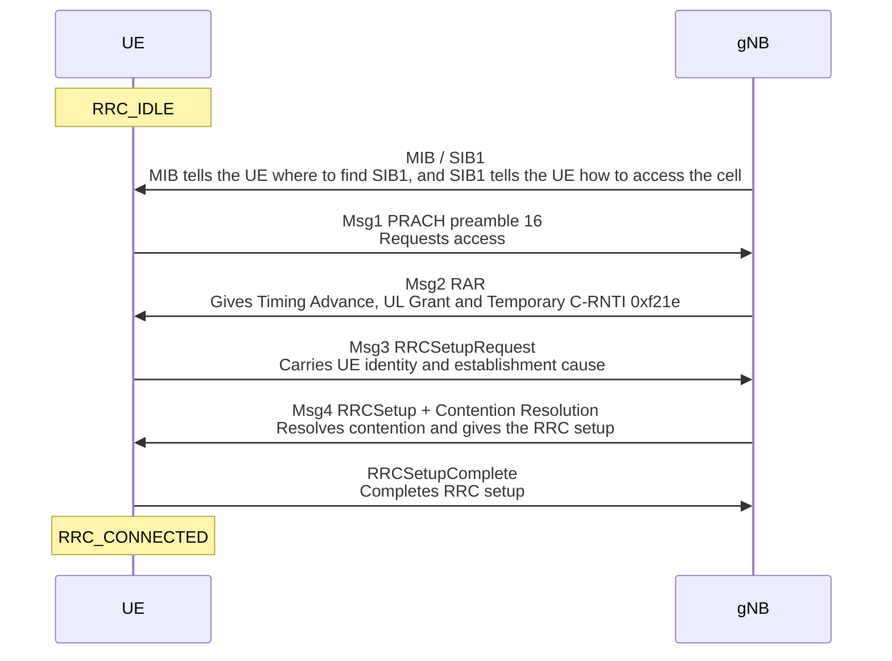


